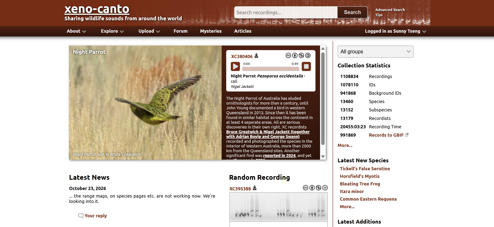
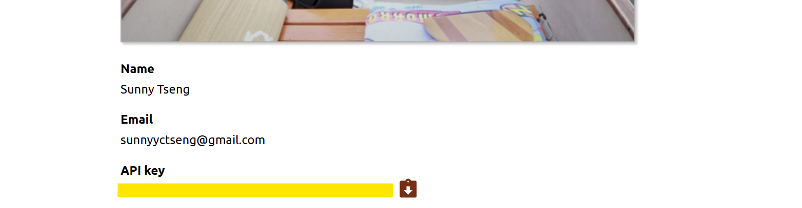

## R + bird (?

Sounds like a great mix of topics!

-   rOpenSci

-   "doing a talk... on any of your projects"

    -   R enthusiast

    -   bird watcher / field recordist

    -   bioacoustics researcher

-   Cool opportunity to meet R Ladies Vancouver folks!


## About me

::::: columns
::: {.column width="65%"}
-   Independent data consultant

-   R user since 2015 (!

    -   script --\> shinyR --\> rmarkdown --\> quarto --\> package development

-   Exploring AI agent in R

    -   claude code
    -   codex
    -   posit agent

-   Carve a pumpkin!
:::

::: {.column width="35%"}

:::
:::::


## How about you

::::: columns
::: {.column width="35%"}
-   Your name

-   Career background

-   Experience with R

-   Halloween plans?
:::

::: {.column width="65%"}

:::
:::::


## Outline

1.  R communities and opportunities
2.  Bird bioacoustics in R

> This is meant to be a interactive session. So feel free to ask questions or drop your thoughts.


# R communities and opportunities


## R community

A community is essential, especially in this fast-changing world

To share experience, information, most updated tools

#### R communities

-   rOpenSci - open tools for open science (2024)

-   R Ladies

## rOpenSci

A community promoting open science


## Championship program

-   10 month program, starting every year fall

-   Scholarship for package development, with mentor paird


## bbsTaiwan

-   What I did with the championship program

## Other initiatives

-   Peer-reviewed package

-   R universe package

-   working hours

-   community call

-   A slack channel


## Posit-conf

-   Opportunity scholar

-   Workshops - Jenny Bryan, Hadley Waker

-   The newest update from the posit - positron announcement


## R Consortium

-   Project fundings

-   


## To summary

#### R communities

-   rOpenSci

-   R Ladies

#### Conferences

-   posit-conf

-   useR!

#### Funding

-   R Consortium (for event, community building, project)

-   OBS (for travelliing)


# Bird bioacoustics in R

```{r}
#| echo: false
#| warning: false
#| message: false

library(tidyverse)
library(here)
library(DT)
```


## R Packages for birds

There are SO many R packages developed for birds

<iframe src="https://beausoleilmo.github.io/Ornithometrics-ctv/Ornithometrics.html" width="100%" height="550" style="border: none;">

</iframe>

## Communication and acoustic analysis {.smaller}

| Step | Package | What it does |
|-------------------|------------------|-----------------------------------|
| **Get recordings** | `suwo` | Search & download Xeno-Canto, Macaulay, iNaturalist |
| **Read / convert** | `tuneR` | Read MP3/WAV, resample, convert |
|  | `av` | Read MP3/WAV, resample, convert |
| **Visualize / measure** | `seewave` | Spectrograms, acoustic measurements |
|  | `warbleR` | Spectrograms, acoustic measurements |
|  | `dynaSpec` | Animated, scrolling spectrograms |
| **Signals detection / identification** | `ohun` | Automatic detection, template matching |
|  | `monitoR` | Automatic detection, template matching |
|  | `birdnetR` | BirdNET in R (Python under the hood) |
|  | `birdnetTools` | Filter, validate, visualize BirdNET output |
| **Soundscapes index** | `soundecology` | Acoustic indices (ACI, NDSI, ...) |

## Our plan

Step 1.  Explore bird songs around the world (`suwo`)

Step 2.  Read and check audio in R (`tuneR`, `seewave`)

Step 3.  Identify species with BirdNET (`birdnetR`, `birdnetTools`)


> Let's play **Name that bird!** :bird:


## Step 1: Explore bird songs

[Xeno-Canto](https://xeno-canto.org): \~1 million wildlife recordings, shared under CC licenses




## The one, and only one function

Use the `query_xenocanto()` function from the `suwo` package:

```{r}
library(suwo)
```

Enter the scientific name of the bird species:

```{r}
#| cache: true
query <- suwo::query_xenocanto(species = "Haliaeetus leucocephalus")
```


```{r}
#| echo: false
datatable(query,
  options = list(
    scrollX = TRUE,      # horizontal scroll (many columns)
    scrollY = "400px",   # vertical scroll within this height
    paging = FALSE,      # show all rows in the scroll box
    dom = "ft"           # just the filter box + table
  ),
  class = "compact",
  rownames = FALSE
)
```


## API in Xeno-Canto

:confounded: You will need API key in the first time

```{r}
#| eval: false
query <- query_xenocanto(species = "Haliaeetus leucocephalus")
```

```{r}
#| error: true
#| echo: false
withr::with_envvar(c(XC_API_KEY = NA), {
  query <- query_xenocanto(species = "Haliaeetus leucocephalus")
})
```

:hand_over_mouth: Register on Xeno-Canto –\> copy API –\> set in R

```{r}
#| eval: false

Sys.setenv(XC_API_KEY = "YOUR_API_KEY_HERE")
```




## Additional search tags {.smaller}

Search tags you can combine:

| Tag | Example | Meaning |
|------------------|-------------------------|-----------------------------|
| `en:` | `en:"Barred Owl"` | English name |
| `q:` | `q:A` | Recording quality (A = best) |
| `len:` | `len:10-40` | Length in seconds |
| `cnt:` | `cnt:canada` | Country |
| `lat:`, `lon:` | `lat: 49.26`, `lon: -123.11` | Latitude and longitude (1 degree) |
| `type:` | `type:song` | Song, call, drumming... |


## American Robins in ...

::: {.panel-tabset}

### Country

```{r}
#| cache: true
amro_canada <- query_xenocanto(species = 'sp: "Turdus migratorius" cnt:"canada"')

```


```{r}
#| echo: false

print(paste0("Number of recordings found: ", nrow(amro_canada)))

datatable(amro_canada,
  options = list(
    scrollX = TRUE,      # horizontal scroll (many columns)
    scrollY = "400px",   # vertical scroll within this height
    paging = FALSE,      # show all rows in the scroll box
    dom = "ft"           # just the filter box + table
  ),
  class = "compact",
  rownames = FALSE
)

```

### City

```{r}
#| cache: true
amro_vancouver <- query_xenocanto(species = 'sp: "Turdus migratorius" lat: "49.26" lon: "-123.11"')
```


```{r}
#| echo: false

print(paste0("Number of recordings found: ", nrow(amro_vancouver)))

datatable(amro_vancouver,
  options = list(
    scrollX = TRUE,      # horizontal scroll (many columns)
    scrollY = "400px",   # vertical scroll within this height
    paging = FALSE,      # show all rows in the scroll box
    dom = "ft"           # just the filter box + table
  ),
  class = "compact",
  rownames = FALSE
)

```


### Recordist

```{r}
#| cache: true
amro_sunny <- query_xenocanto(species = 'sp: "Turdus migratorius" lat: "49.26" lon: "-123.11" rec: "Sunny"')
```


```{r}
#| echo: false

print(paste0("Number of recordings found: ", nrow(amro_sunny)))


datatable(amro_sunny,
  options = list(
    scrollX = TRUE,      # horizontal scroll (many columns)
    scrollY = "400px",   # vertical scroll within this height
    paging = FALSE,      # show all rows in the scroll box
    dom = "ft"           # just the filter box + table
  ),
  class = "compact",
  rownames = FALSE
)

```

:::


## Download audios

Use the `download_media()` function from the `suwo` package.

- It can be one single audio download:

```{r}
#| echo: false
audio_dir <- here("presentation slides", "audio")
dir.create(audio_dir, showWarnings = FALSE)
```


```{r}
#| cache: true
#| message: true
download_media(metadata = amro_sunny[1,],
               path = audio_dir)
```

- Or a batch download:

```{r}
#| cache: true
#| message: true
download_media(metadata = amro_sunny,
               path = audio_dir)
```


## Step 2: Read and check audio in R

Use the `readWave()` or `readMP3()` function from the `tuneR` package.

```{r}
library(tuneR)
```


Let's target the newest download in the `audio_dir` folder:

```{r}
audio_path <- tibble(path = list.files(audio_dir, pattern = "\\.(mp3|wav)$",
                                 full.names = TRUE, ignore.case = TRUE)) |>
  mutate(modified = file.mtime(path)) |>
  slice_min(modified, n = 1) |> 
  pull(path)

audio_path
```

Check the file extension and read it accordingly:
```{r}
ext <- tolower(tools::file_ext(audio_path))

if (ext == "mp3") {
  audio <- readMP3(audio_path)
} else if (ext == "wav") {
  audio <- readWave(audio_path)
}
```


## Listen 

To listen, use the `play()` function from the `tuneR` package:


```{r}
library(tuneR)
```

Indicate the audio object:

```{r}
#| eval: false
audio |> 
  play()
```

```{r}
#| echo: false
htmltools::tags$audio(src = "audio/Turdus_migratorius-XC465001.mp3",
                      controls = NA)
```


## Look

To visualize, use the `spectro()` function from the `seewave` package:

```{r}
library(seewave)
```

Indicate the audio abject:

```{r}
#| fig-width: 28
#| out-width: "100%"
audio |>
  extractWave(from = 2, to = 11, xunit = "time") |>
  spectro(flim = c(1, 6),
          fastdisp = TRUE)
```


. . .

-   **x-axis**: time, **y-axis**: pitch, **darkness**: loudness
-   Every species has a "shape" you can learn to read


## Step 3: Identify species with BirdNET

Use the `predict()` function from the `birdnetR` package.

```{r}
library(birdnetR)
```

Need to load the BirdNET model first:

```{r}
#| eval: false
model <- load_birdnet()

predictions <- predict(model,
                       files = audio_path,
                       min_confidence = 0.3)
```


```{r}
#| echo: false
#| messages: false

if (file.exists("birdnet_results.rds")) {
  df <- readRDS("birdnet_results.rds")
} else {
  model <- load_birdnet()
  df <- predict(model, files = audio_path, min_confidence = 0.3) |>
    as.data.frame()
  saveRDS(df, "birdnet_results.rds")
}

df |> 
select(-input) |>
datatable(
  options = list(
    scrollX = TRUE,
    scrollY = "400px",
    paging = FALSE,
    dom = "ft"
  ),
  class = "compact",
  rownames = FALSE
)

```


## Put everything together

Step 1.  Explore bird songs around the world (`suwo`)

Step 2.  Read and check audio in R (`tuneR`, `seewave`)

Step 3.  Identify species with BirdNET (`birdnetR`, `birdnetTools`)


> Let's play **Name that bird!** :bird:


### How to pay

1. **Player A** picks a random recording
2. **Player B** listens and guesses the species

**BirdNET** reveals the answer! :heart:


## Name that bird setup

Xeno-Canto Vancouver-area, songs, quality A:

```{r}
#| cache: true
vancouver_birds <- query_xenocanto(species = 'lat: "49.26" lon: "-123.11" type: "song" q:"A"')
```

Here is the subset "answer sheet" (66 species, 122 recordings): 

```{r}
#| echo: false

set.seed(123)
vancouver_birds_selected <- vancouver_birds |>
  group_by(species) |>
  slice_sample(n = 2) |>
  ungroup()

vancouver_birds_selected |>
mutate(number = row_number()) |>
select(number, key, species, date, time, user_name, locality, file_extension) |>
datatable(
  options = list(
    scrollX = TRUE,      # horizontal scroll (many columns)
    scrollY = "400px",   # vertical scroll within this height
    paging = FALSE,      # show all rows in the scroll box
    dom = "ft"           # just the filter box + table
  ),
  class = "compact",
  rownames = FALSE
)
```


## Ready? 


## From 5 clips to 50,000 hours

Real projects: hundreds of recorders × months of audio. Enter **`birdnetTools`**:

## Recap: listening to birds in R

1.  **Get**: Xeno-Canto API v3 (`httr2`, `suwo`)
2.  **Listen & look**: `tuneR`, `seewave`
3.  **Identify**: `birdnetR` + a location filter
4.  **Check**: `birdnetTools` validation & thresholds

. . .

> Don't trust the robot blindly: **listen** to your data!
