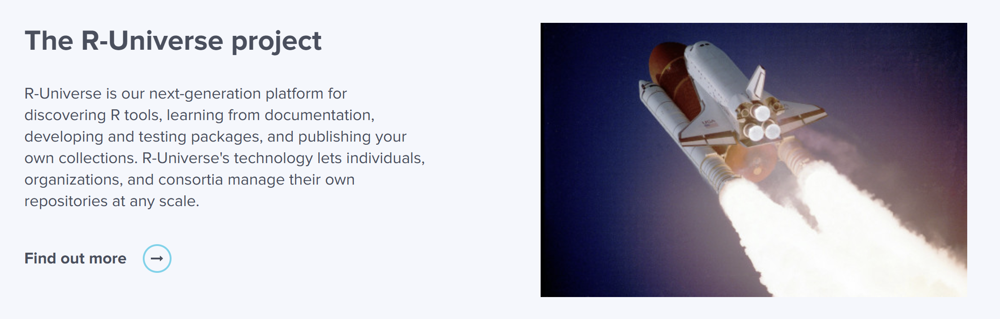
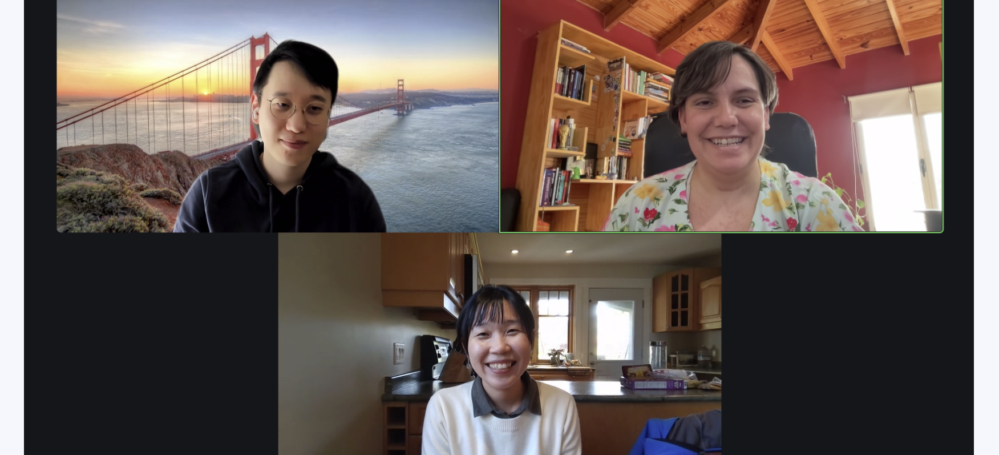
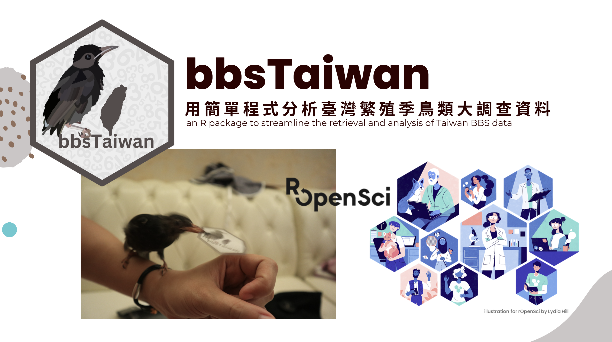
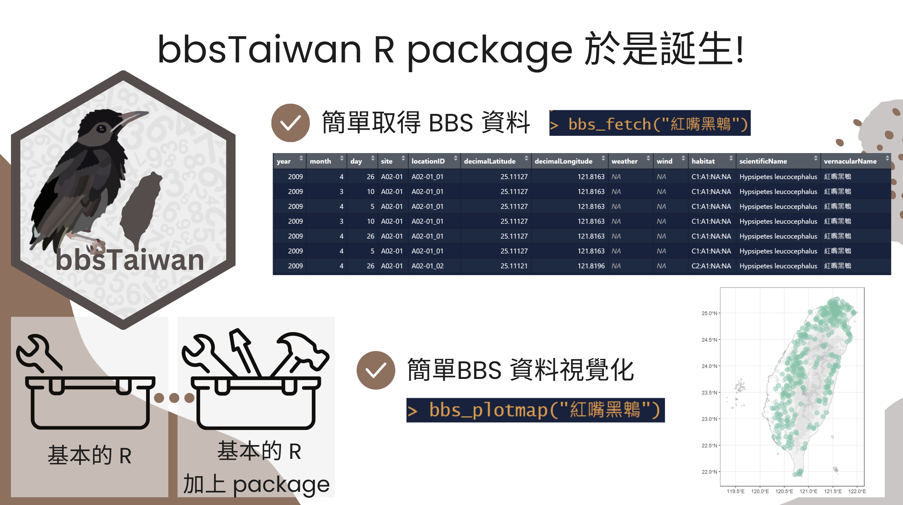
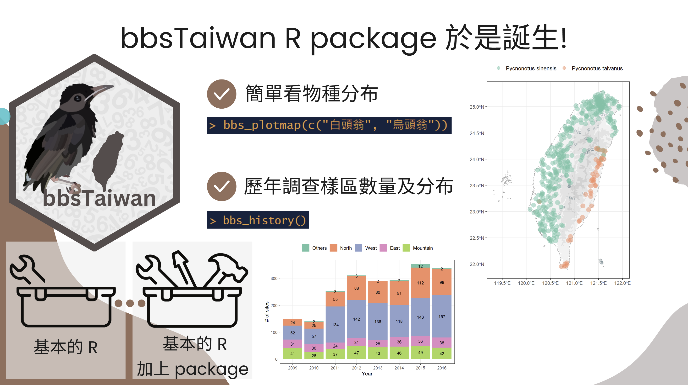
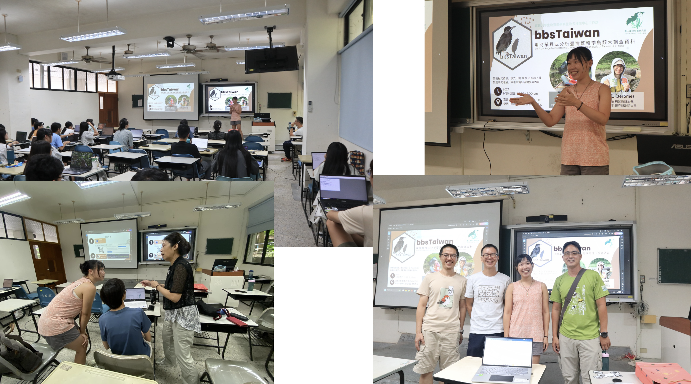
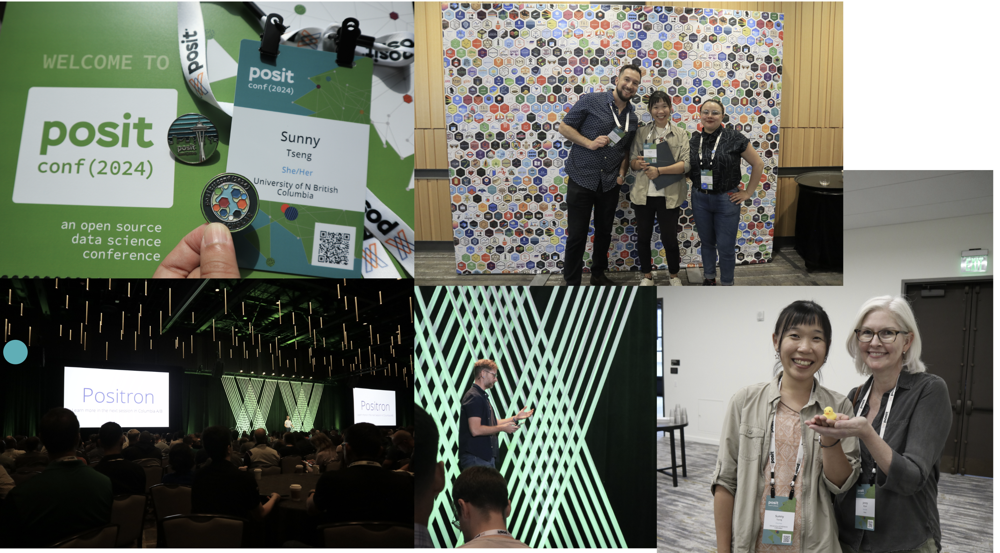
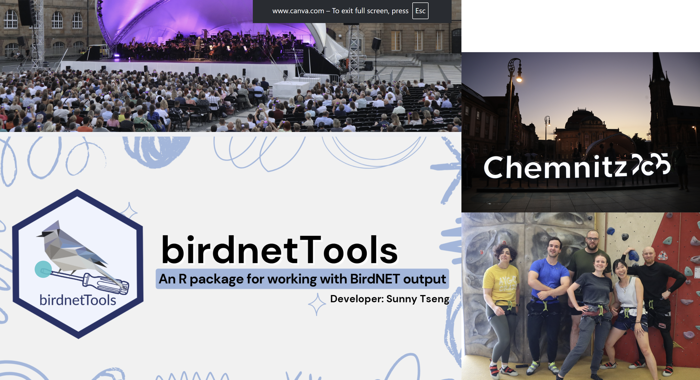
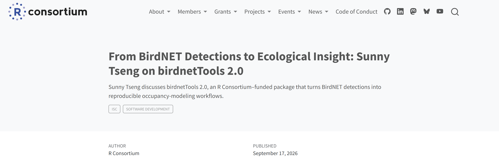
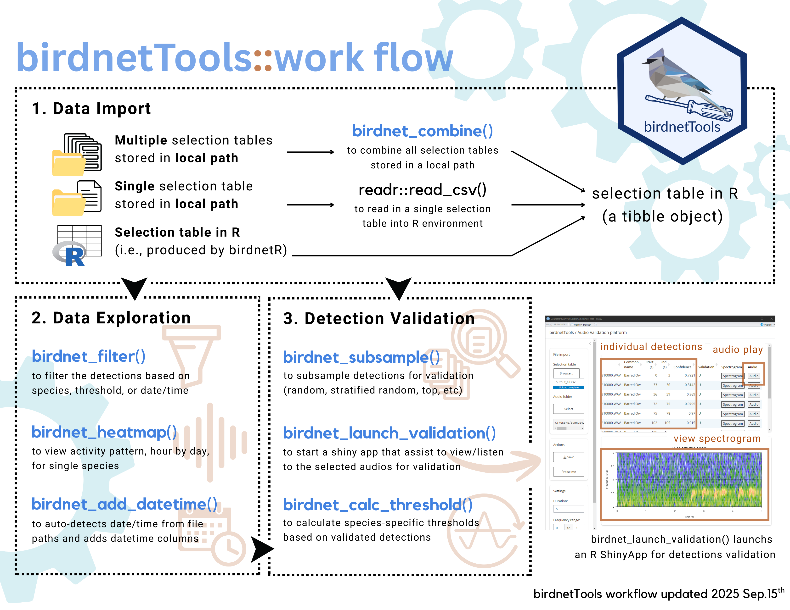

## R + bird (?

Sounds like a great mix of topics!

-   "doing a talk... on any of your projects"

    -   R enthusiast

    -   bird watcher / field recordist

    -   bioacoustics researcher

-   Cool opportunity to meet R folks in Vancouver!

## About me

::::: columns
::: {.column width="65%"}
-   Independent data consultant

-   R user since 2015

    -   script --\> shinyR --\> rmarkdown --\> quarto --\> package development

    -   using AI agent in R

-   Sound recording

-   Hip hop dancing
:::

::: {.column width="35%"}

:::
:::::

## How about you

:::::: columns
:::: {.column width="35%"}
-   Your name

-   Career background

-   Experience with R

-   New learning plan?

-   Halloween plans?

::: fragment
> Nice to meet you all!
:::
::::

::: {.column width="65%"}

:::
::::::

::: aside
Artwork by [\@allison_horst](https://allisonhorst.com/), CC BY 4.0
:::

## Outline

1.  Communities and opportunities
2.  Bird bioacoustics research in R

. . .

> This talk / presentation / workshop is meant to be a interactive session. So feel free to ask questions or drop your thoughts.

# R communities and opportunities

## rOpenSci

A non-profit initiative that supports open and reproducible research

. . .


## Their main programs

-   Software peer review (pre-JOSS fast-track)

-   The R universe project (binary package, CRAN)

. . .



## Community activities

-   Slack channels (new tools, jobs, gen-AI, etc.)

-   Monthly co-working sessions (worldwide)

-   Colleague coffee chats

. . .


## Championship program 2023

-   10 month program, starting every year fall

-   Scholarship for package development, with a paired mentor

-   They fund you, and teach you build a package!

. . .



## bbsTaiwan

To streamline the retrieval and analysis of Taiwan Breeding Birds Survey data

{fig-align="center"}

## bbsTaiwan

This package can fetch the breeding birds survey data in one line of code



## bbsTaiwan

Also provide functions to visualize the distribution of the species



## Community building

Contribute back to my home country with open source package



## Posit::conf 2024

Opportunity scholar, workshops, super stars, news in R (Positron in 2024)!

{fig-align="center"}

## NSERC MSFSS 2025

A 3 month visiting scholar in Chemnitz, Germany, to build `birdnetTools`



## R Consortium 2026

Grant for developers and **community members** working on projects that improve R’s infrastructure, packages, and community.



## R communities and opportunities

One opportunity is connected to the next one

-   rOpenSci - community

-   posit::conf - inspiration

-   NSERC MSFSS - collaboration

-   R Consortium - contribution

. . .

-   R Ladies

-   useR!

-   OBF event award

-   ... do you know any more opportunities?

# Bird bioacoustics in R

```{r}
#| echo: false
#| warning: false
#| message: false

library(tidyverse)
library(here)
library(DT)
```

## R Packages for birds

There are SO many R packages developed for birds

. . .

<iframe src="https://beausoleilmo.github.io/Ornithometrics-ctv/Ornithometrics.html" width="100%" height="550" style="border: none;">

</iframe>

## Communication and acoustic analysis {.smaller}

| Step | Package | What it does |
|-------------------|------------------|-----------------------------------|
| **Get recordings** | `suwo` | Search & download Xeno-Canto, Macaulay, iNaturalist |
| **Read / convert** | `tuneR` | Read MP3/WAV, resample, convert |
|  | `av` | Read MP3/WAV, resample, convert |
| **Visualize / measure** | `seewave` | Spectrograms, acoustic measurements |
|  | `warbleR` | Spectrograms, acoustic measurements |
|  | `dynaSpec` | Animated, scrolling spectrograms |
| **Signals detection / identification** | `ohun` | Automatic detection, template matching |
|  | `monitoR` | Automatic detection, template matching |
|  | `birdnetR` | BirdNET in R (Python under the hood) |
|  | `birdnetTools` | Filter, validate, visualize BirdNET output |
| **Soundscapes index** | `soundecology` | Acoustic indices (ACI, NDSI, ...) |

## General workflow

This is a simplified research workflow, but carries the main steps of a bioacoustics project

. . .

Step 1. Explore bird songs around the world (`suwo`)

. . .

Step 2. Read and check audio in R (`tuneR`, `seewave`)

. . .

Step 3. Identify species with BirdNET (`birdnetR`, `birdnetTools`)

. . .

> Let's play **Name that bird!** :bird:

## Step 1: Explore bird songs

[Xeno-Canto](https://xeno-canto.org): \~1 million wildlife recordings, shared under CC licenses


## The one, and only one function

. . .

Use the `query_xenocanto()` function from the `suwo` package:

```{r}
library(suwo)
```

. . .

Enter the scientific name of the bird species:

```{r}
#| cache: true
query <- suwo::query_xenocanto(species = "Haliaeetus leucocephalus")
```


. . .

```{r}
#| echo: false
datatable(query,
  options = list(
    scrollX = TRUE,      # horizontal scroll (many columns)
    scrollY = "400px",   # vertical scroll within this height
    paging = FALSE,      # show all rows in the scroll box
    dom = "ft"           # just the filter box + table
  ),
  class = "compact",
  rownames = FALSE
)
```

## API in Xeno-Canto

. . .

:confounded: You will need API key in the first time

```{r}
#| eval: false
query <- query_xenocanto(species = "Haliaeetus leucocephalus")
```

```{r}
#| error: true
#| echo: false
withr::with_envvar(c(XC_API_KEY = NA), {
  query <- query_xenocanto(species = "Haliaeetus leucocephalus")
})
```

. . .

:hand_over_mouth: Register on Xeno-Canto –\> copy API –\> set in R

```{r}
#| eval: false

Sys.setenv(XC_API_KEY = "YOUR_API_KEY_HERE")
```


## Additional search tags {.smaller}

Search tags you can combine:

| Tag | Example | Meaning |
|------------------|-------------------------|-----------------------------|
| `en:` | `en:"Barred Owl"` | English name |
| `q:` | `q:A` | Recording quality (A = best) |
| `len:` | `len:10-40` | Length in seconds |
| `cnt:` | `cnt:canada` | Country |
| `lat:`, `lon:` | `lat: 49.26`, `lon: -123.11` | Latitude and longitude (1 degree) |
| `type:` | `type:song` | Song, call, drumming... |

## Black-capped Chickadee in ...

::: panel-tabset
### Country

```{r}
#| cache: true
bcch_canada <- query_xenocanto(species = 'sp: "Poecile atricapillus" cnt:"canada"')

```

```{r}
#| echo: false

print(paste0("Number of recordings found: ", nrow(bcch_canada)))

datatable(bcch_canada,
  options = list(
    scrollX = TRUE,      # horizontal scroll (many columns)
    scrollY = "400px",   # vertical scroll within this height
    paging = FALSE,      # show all rows in the scroll box
    dom = "ft"           # just the filter box + table
  ),
  class = "compact",
  rownames = FALSE
)

```

### City

```{r}
#| cache: true
bcch_vancouver <- query_xenocanto(species = 'sp: "Poecile atricapillus" lat: "49.26" lon: "-123.11"')
```

```{r}
#| echo: false

print(paste0("Number of recordings found: ", nrow(bcch_vancouver)))

datatable(bcch_vancouver,
  options = list(
    scrollX = TRUE,      # horizontal scroll (many columns)
    scrollY = "400px",   # vertical scroll within this height
    paging = FALSE,      # show all rows in the scroll box
    dom = "ft"           # just the filter box + table
  ),
  class = "compact",
  rownames = FALSE
)

```

### Recordist

```{r}
#| cache: true
bcch_sunny <- query_xenocanto(species = 'sp: "Poecile atricapillus" lat: "49.26" lon: "-123.11" rec: "Sunny"')
```

```{r}
#| echo: false

print(paste0("Number of recordings found: ", nrow(bcch_sunny)))


datatable(bcch_sunny,
  options = list(
    scrollX = TRUE,      # horizontal scroll (many columns)
    scrollY = "400px",   # vertical scroll within this height
    paging = FALSE,      # show all rows in the scroll box
    dom = "ft"           # just the filter box + table
  ),
  class = "compact",
  rownames = FALSE
)

```
:::

## Download audios

. . .

Use the `download_media()` function from the `suwo` package.

-   It can be one single audio download:

. . .

```{r}
#| echo: false
audio_dir <- here("presentation slides", "audio")
dir.create(audio_dir, showWarnings = FALSE)
```

```{r}
#| cache: true
#| message: true
download_media(metadata = bcch_sunny[1,],
               path = audio_dir)
```

-   Or a batch download:

. . .

```{r}
#| cache: true
#| message: true
download_media(metadata = bcch_sunny,
               path = audio_dir)
```

## Step 2: Read and check audio in R

. . .

Use the `readWave()` or `readMP3()` function from the `tuneR` package.

```{r}
library(tuneR)
```

. . .

Let's read one audio in the `audio_dir` folder:

```{r}
audio_path <- tibble(path = list.files(audio_dir, pattern = "\\.(mp3|wav)$",
                                 full.names = TRUE, ignore.case = TRUE)) |>
  mutate(modified = file.mtime(path)) |>
  slice_max(modified, n = 1) |> 
  pull(path)

audio_path
```

. . .

Check the file extension and read it accordingly:

```{r}
ext <- tolower(tools::file_ext(audio_path))

if (ext == "mp3") {
  audio <- readMP3(audio_path)
} else if (ext == "wav") {
  audio <- readWave(audio_path)
}
```

## Listen

. . .

To listen, use the `play()` function from the `tuneR` package:

```{r}
library(tuneR)
```

. . .

Indicate the audio object:

```{r}
#| eval: false
audio |> 
  play()
```

```{r}
#| echo: false
htmltools::tags$audio(src = "audio/Poecile_atricapillus-XC531549.mp3",
                      controls = NA)
```

## Look

. . .

To visualize, use the `spectro()` function from the `seewave` package:

```{r}
library(seewave)
```

. . .

Indicate the audio abject:

```{r}
#| fig-width: 28
#| out-width: "100%"
audio |>
  extractWave(from = 2, to = 11, xunit = "time") |>
  spectro(flim = c(2, 9),
          fastdisp = TRUE)
```

-   **x-axis**: time, **y-axis**: pitch, **darkness**: loudness
-   Every species has a "shape" you can learn to read

## Step 3: Identify species with BirdNET

. . .

Use the `predict()` function from the `birdnetR` package.

```{r}
library(birdnetR)
```

. . .

Load model and run prediction:

```{r}
#| eval: false
model <- load_birdnet()

predictions <- predict(model,
                       files = audio_path,
                       min_confidence = 0.3)
```

. . .

```{r}
#| echo: false
#| messages: false

if (file.exists("birdnet_results.rds")) {
  df <- readRDS("birdnet_results.rds")
} else {
  model <- load_birdnet()
  df <- predict(model, files = audio_path, min_confidence = 0.3) |>
    as.data.frame()
  saveRDS(df, "birdnet_results.rds")
}

df |> 
select(-input) |>
datatable(
  options = list(
    scrollX = TRUE,
    scrollY = "400px",
    paging = FALSE,
    dom = "ft"
  ),
  class = "compact",
  rownames = FALSE
)

```

## Put everything together

. . .

Step 1. Explore bird songs around the world (`suwo`)

. . .

Step 2. Read and check audio in R (`tuneR`, `seewave`)

. . .

Step 3. Identify species with BirdNET (`birdnetR`, `birdnetTools`)

. . .

> Let's play **Name that bird!** :bird:

## Guess the birds in Vancouver!

Vancouver-area, songs, high quality recordings:

```{r}
#| cache: true
vancouver_birds <- query_xenocanto(species = 'lat: "49.26" lon: "-123.11" type: "song" q:"A"')
```

. . .

Sebset - here is the "answer sheet" (66 species, 112 recordings):

```{r}
#| echo: false

set.seed(123)
vancouver_birds_selected <- vancouver_birds |>
  group_by(species) |>
  slice_sample(n = 2) |>
  ungroup()

vancouver_birds_selected |>
mutate(number = row_number()) |>
select(number, key, species, date, time, user_name, locality, file_extension) |>
datatable(
  options = list(
    scrollX = TRUE,      # horizontal scroll (many columns)
    scrollY = "400px",   # vertical scroll within this height
    paging = FALSE,      # show all rows in the scroll box
    dom = "ft"           # just the filter box + table
  ),
  class = "compact",
  rownames = FALSE
)
```

## How to play

1.  **Player A** picks a random recording
2.  **Player B** listens and guesses the species

::: fragment
**BirdNET** reveals the answer! :heart:
:::

. . .

> Ready?

```{r}
#| echo: false
#| message: false

birdnet <- list.files(here("presentation slides", "audio_game_output"),
                      pattern = "\\.BirdNET\\.results\\.csv$",
                      full.names = TRUE) |>
  read_csv(id = "csv_file", show_col_types = FALSE) |>
  mutate(base = str_extract(basename(csv_file), "^[^.]+")) |>
  select(base,
         start       = `Start (s)`,
         end         = `End (s)`,
         common_name = `Common name`,
         scientific  = `Scientific name`,
         confidence  = Confidence) |>
  arrange(base, start)

game <- vancouver_birds_selected |>
  mutate(base  = paste0(str_replace_all(species, " ", "_"), "-XC", key),
         audio = file.path("audio_game", paste0(base, ".", file_extension)),
         spec  = file.path("audio_game_spectrogram", paste0(base, ".png"))) |>
  mutate(id = row_number()) |>
  select(id, base, species, key, user_name, locality, audio, spec)

ojs_define(game = game, birdnet = birdnet)
```

## :video_game: Who's singing?

```{ojs}
//| echo: false
birds = transpose(game)

viewof i = Inputs.number([1, birds.length],
  {step: 1, value: 1, label: `Pick a number (1–${birds.length})`})

bird = birds[i - 1]

html`<audio controls src="${bird.audio}" style="width:100%"></audio>`

html``

detections = transpose(birdnet).filter(d => d.base === bird.base)
```

## :bird: And the answer is...

```{ojs}
//| echo: false
md`**Xeno-Canto label:** 

*${bird.species}*, recorded by ${bird.user_name} (XC${bird.key})

**BirdNET detection:**`

detections.length === 0
  ? md`No detection`
  : Inputs.table(detections, {
  columns: ["start", "end", "common_name", "scientific", "confidence"],
  header: {start: "Start (s)", end: "End (s)", common_name: "Common name",
           scientific: "Scientific name", confidence: "Confidence"},
  format: {confidence: x => x.toFixed(2)},
  height: 450})
```

## From 5 clips to 50,000 hours

Real projects: hundreds of recorders × months of audio. Enter `birdnetTools`

{fig-align="center"}

## Recap: R + birds

1.  Communities and opportunities
2.  Packages for bird bioacoustics
3.  The game for rainy Vancouver
4.  R is fun!

. . .

> Thank you!

::: aside
Presentation by Sunny Tseng <https://sunnytseng.ca/>, CC BY 4.0
:::
