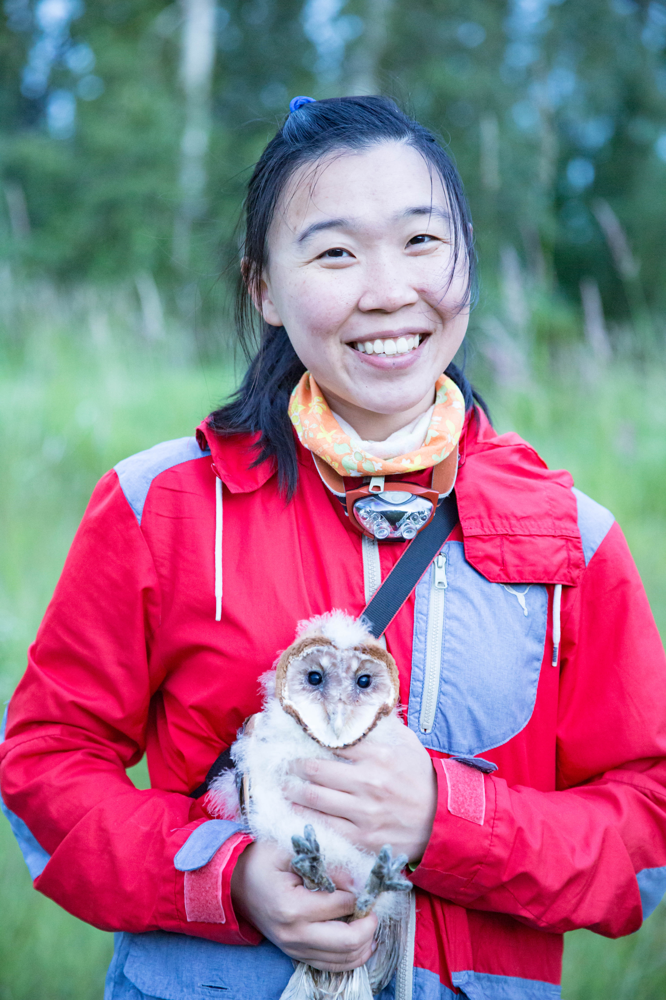
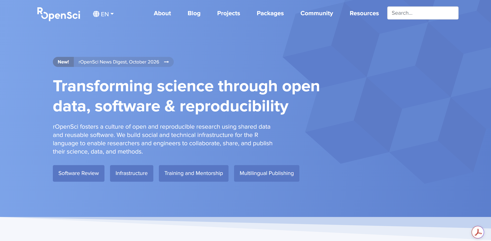

## R + bird (?

Sounds like a great mix of topics!

-   rOpenSci

-   "doing a talk... on any of your projects"

    -   R enthusiast

    -   bird watcher / field recordist

    -   bioacoustics researcher

-   Cool opportunity to meet R Ladies Vancouver folks!

## About me

::::: columns
::: {.column width="65%"}
-   Independent data consultant

-   R user since 2015 (!

    -   script --\> shinyR --\> rmarkdown --\> quarto --\> package development

-   Exploring AI agent in R

    -   claude code
    -   codex
    -   posit agent

-   Carve a pumpkin!
:::

::: {.column width="35%"}

:::
:::::

## How about you

::::: columns
::: {.column width="35%"}
-   Your name

-   Career background

-   Experience with R

-   Halloween plans?
:::

::: {.column width="65%"}

:::
:::::

## Outline

1.  R communities and opportunities
2.  Listen to some birds in R

> This is meant to be a interactive session. So feel free to ask questions or drop your thoughts.

# R communities and opportunities

## R community

A community is essential, especially in this fast-changing world

To share experience, information, most updated tools

#### R communities

-   rOpenSci - open tools for open science (2024)

-   R Ladies

## rOpenSci

A community promoting open science



## Championship program

-   10 month program, starting every year fall

-   Scholarship for package development, with mentor paird

## bbsTaiwan

-   What I did with the championship program

## Other initiatives

-   Peer-reviewed package

-   R universe package

-   working hours

-   community call

-   A slack channel

## Posit-conf

-   Opportunity scholar

-   Workshops - Jenny Bryan, Hadley Waker

-   The newest update from the posit - positron announcement

## R Consortium

-   Project fundings

-   

## To summary

#### R communities

-   rOpenSci

-   R Ladies

#### Conferences

-   posit-conf

-   useR!

#### Funding

-   R Consortium (for event, community building, project)

-   OBS (for travelliing)

# Listen to some birds

```{r}
#| label: birds-setup
#| include: false
# All heavy lifting (downloads, BirdNET) happens in prep_audio.R.
# Here we only read the cached results, so rendering stays fast and offline.
library(dplyr)
library(knitr)

has_birds <- file.exists("data/scorecard.rds")

if (has_birds) {
  xc_meta       <- readRDS("data/xc_meta.rds")
  local_species <- readRDS("data/local_species.rds")
  birdnet_all   <- readRDS("data/birdnet_all.rds")
  birdnet_local <- readRDS("data/birdnet_local.rds")
  scorecard     <- readRDS("data/scorecard.rds")
}

top_species <- function(detections) {
  detections |>
    group_by(xc_id) |>
    slice_max(confidence, n = 1, with_ties = FALSE) |>
    ungroup() |>
    select(xc_id, common_name, confidence)
}
```

## Packages for birds / bioacoustics {.smaller}

| Step | Package | What it does |
|----|----|----|
| **Get recordings** | `suwo` | Search & download Xeno-Canto, Macaulay, iNaturalist |
| **Read / convert** | `tuneR` | Read MP3/WAV, resample, convert |
|  | `av` | Read MP3/WAV, resample, convert |
| **Visualize / measure** | `seewave` | Spectrograms, acoustic measurements |
|  | `warbleR` | Spectrograms, acoustic measurements |
|  | `dynaSpec` | Animated, scrolling spectrograms |
| **Signals detection / identification** | `ohun` | Automatic detection, template matching |
|  | `monitoR` | Automatic detection, template matching |
|  | `birdnetR` | BirdNET in R (Python under the hood) |
|  | `birdnetTools` | Filter, validate, visualize BirdNET output |
| **Soundscapes index** | `soundecology` | Acoustic indices (ACI, NDSI, ...) |

## Today's plan

```{mermaid}
flowchart LR
  A[Xeno-Canto<br>search] --> B[Download<br>MP3]
  B --> C[Listen &<br>look]
  C --> D[BirdNET]
  D --> E{Did it get<br>it right?}
  E --> F[birdnetTools]
```

. . .

> Let's play **Name that bird!** 🐦

## Step 1: Ask Xeno-Canto

[xeno-canto.org](https://xeno-canto.org): \~1 million wildlife recordings, shared under Creative Commons

```{r}
#| eval: false
#| code-line-numbers: "|1-2|4-7"
library(httr2)
Sys.getenv("XC_API_KEY")    # free key from xeno-canto.org/account

request("https://xeno-canto.org/api/3/recordings") |>
  req_url_query(query = 'en:"Varied Thrush" q:A len:10-40',
                key   = Sys.getenv("XC_API_KEY")) |>
  req_perform() |>
  resp_body_json(simplifyVector = TRUE)
```

::: callout-tip
Xeno-Canto has retired API v2, so `warbleR::query_xc()` no longer works. Use API v3 (with a key), or try the newer `suwo` package.
:::

## Step 2: Download

```{r}
#| eval: false
library(purrr)

walk2(xc_meta$download_url, xc_meta$mp3, \(url, dest) {
  request(url) |> req_perform(path = dest)
})
```

. . .

Search tags you can combine:

| Tag     | Example           | Meaning                      |
|---------|-------------------|------------------------------|
| `en:`   | `en:"Barred Owl"` | English name                 |
| `q:`    | `q:A`             | Recording quality (A = best) |
| `len:`  | `len:10-40`       | Length in seconds            |
| `cnt:`  | `cnt:canada`      | Country                      |
| `type:` | `type:song`       | Song, call, drumming...      |

## Step 3: Listen & look

```{r}
#| eval: false
library(tuneR)
library(seewave)

wav <- readMP3("audio/XC123456.mp3")
wav <- ffilter(wav, from = 1000, output = "Wave")   # drop low rumble

spectro(wav, flim = c(0, 10), collevels = seq(-40, 0, 1))
```

. . .

-   **x-axis**: time, **y-axis**: pitch, **darkness**: loudness
-   Every species has a "shape" you can learn to read

```{r}
#| label: name-that-bird
#| output: asis
#| echo: false
if (has_birds) {
  for (i in seq_len(nrow(xc_meta))) {
    rec  <- xc_meta[i, ]
    pick <- scorecard[scorecard$xc_id == rec$xc_id, ]

    cat("\n\n## Name that bird! #", i, "\n\n", sep = "")
    cat('<audio controls src="audio/', basename(rec$mp3), '"></audio>\n\n', sep = "")
    cat("{height=330}\n\n", sep = "")
    cat(":::: {.columns}\n")
    cat("::: {.column width=\"50%\" .fragment}\n**BirdNET says:** ", pick$birdnet_says,
        if (!is.na(pick$max_conf)) sprintf(" (%.2f)", pick$max_conf), "\n:::\n", sep = "")
    cat("::: {.column width=\"50%\" .fragment}\n**Xeno-Canto:** ", rec$common_name, " ",
        if (isTRUE(pick$correct)) "✅" else "❌", "\n:::\n::::\n\n", sep = "")
    cat("::: aside\n", rec$xc_id, " · ", rec$recordist, " · ", rec$location,
        " · [licence](", rec$licence, ")\n:::\n\n", sep = "")
  }
} else {
  cat("\n\n## Name that bird!\n\n*Run `prep_audio.R` first to fetch the recordings.*\n\n")
}
```

## Step 4: Run BirdNET {.smaller}

```{r}
#| eval: false
library(birdnetR)

model <- load_birdnet(type = "acoustic")    # BirdNET v2.4, ~6,500 species

predict(model, files = "audio/XC123456.mp3", min_confidence = 0.1) |>
  as.data.frame()
```

. . .

```{r}
#| echo: false
if (has_birds) {
  birdnet_all |>
    select(xc_id, start_time, end_time, common_name, confidence) |>
    head(4) |>
    kable(digits = 2)
}
```

-   Splits audio into **3-second** windows and scores every species in each one

## Step 5: Use location

```{r}
#| eval: false
geo <- load_birdnet(type = "geo")

local_species <- predict(geo, latitude = 49.28, longitude = -123.12,
                         week = 43) |>          # Vancouver, late October
  as.data.frame()

predict(model, files = "audio/XC123456.mp3",
        species_list = local_species$species_name)
```

. . .

```{r}
#| echo: false
#| results: asis
if (has_birds) {
  cat("The geo model expects **", nrow(local_species),
      "** species in Vancouver this week, out of ~6,500.\n\n", sep = "")

  top_species(birdnet_all) |>
    left_join(top_species(birdnet_local), by = "xc_id",
              suffix = c("_global", "_vancouver")) |>
    kable(digits = 2,
          col.names = c("Recording", "Global", "conf.", "Vancouver only", "conf."))
}
```

## Scorecard

```{r}
#| echo: false
if (has_birds) {
  scorecard |>
    mutate(correct = if_else(correct, "✅", "❌")) |>
    select(xc_id, xeno_canto_says, birdnet_says, max_conf, correct) |>
    kable(digits = 2,
          col.names = c("Recording", "Xeno-Canto", "BirdNET", "Confidence", ""))
}
```

. . .

::: callout-important
A BirdNET **confidence score is not a probability**. Pick thresholds per species, using validated data (Wood & Kahl 2024).
:::

## From 5 clips to 50,000 hours

Real projects: hundreds of recorders × months of audio. Enter **`birdnetTools`**:

```{r}
#| eval: false
library(birdnetTools)

detections <- birdnet_combine("path/to/birdnet/output")      # read everything

birdnet_launch_validation(detections)                         # Shiny app: listen & verify

thresholds <- birdnet_calc_threshold(validated, precision = 0.9)

detections |>
  birdnet_filter(threshold = thresholds) |>                   # species-specific cut-offs
  birdnet_heatmap(species = "Varied Thrush")
```

## Recap: listening to birds in R

1.  **Get**: Xeno-Canto API v3 (`httr2`, `suwo`)
2.  **Listen & look**: `tuneR`, `seewave`
3.  **Identify**: `birdnetR` + a location filter
4.  **Check**: `birdnetTools` validation & thresholds

. . .

> Don't trust the robot blindly: **listen** to your data!
